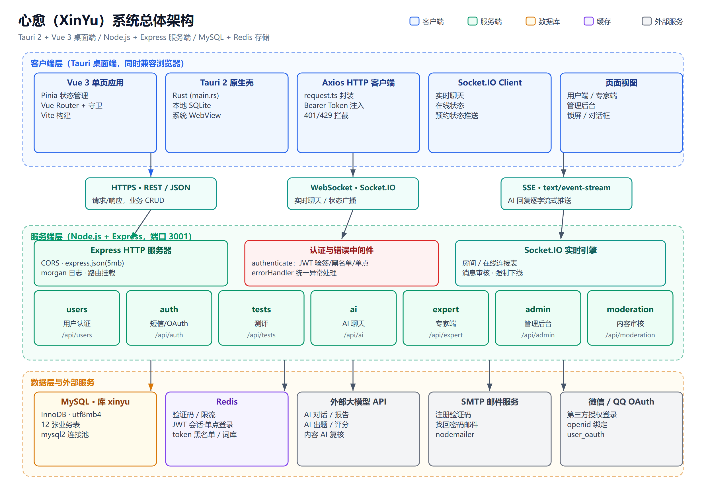
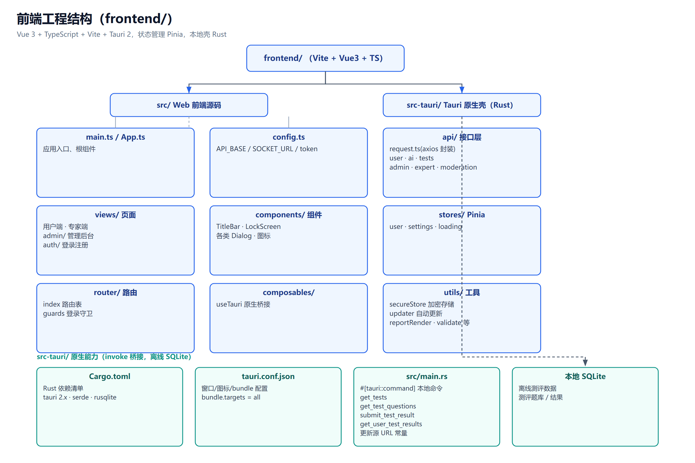
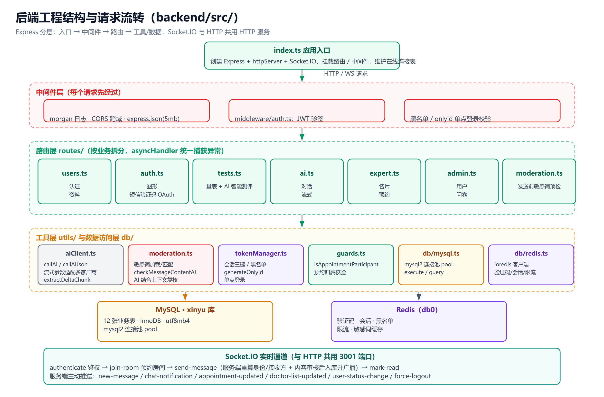
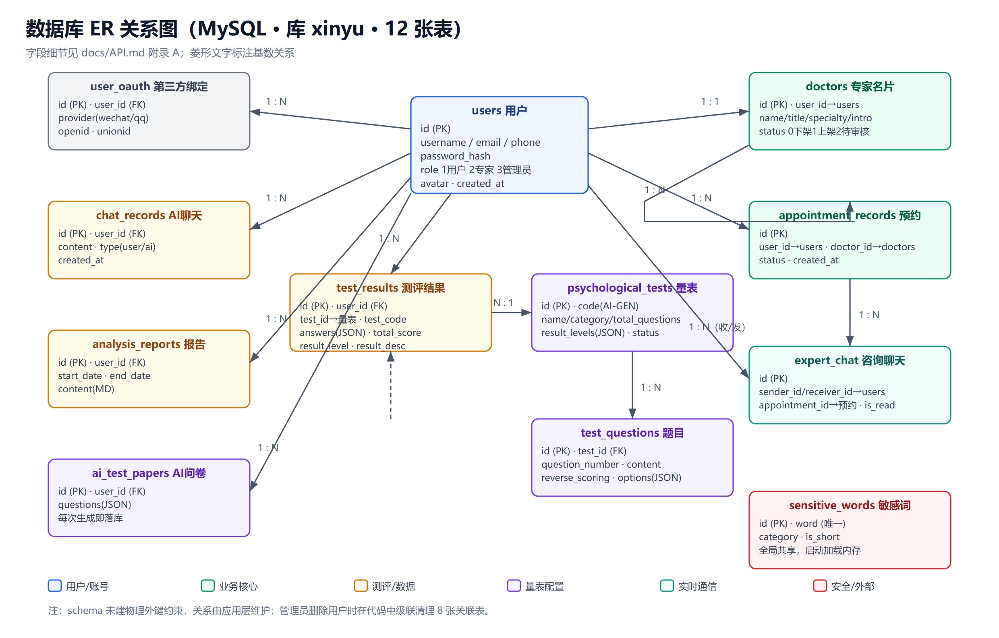
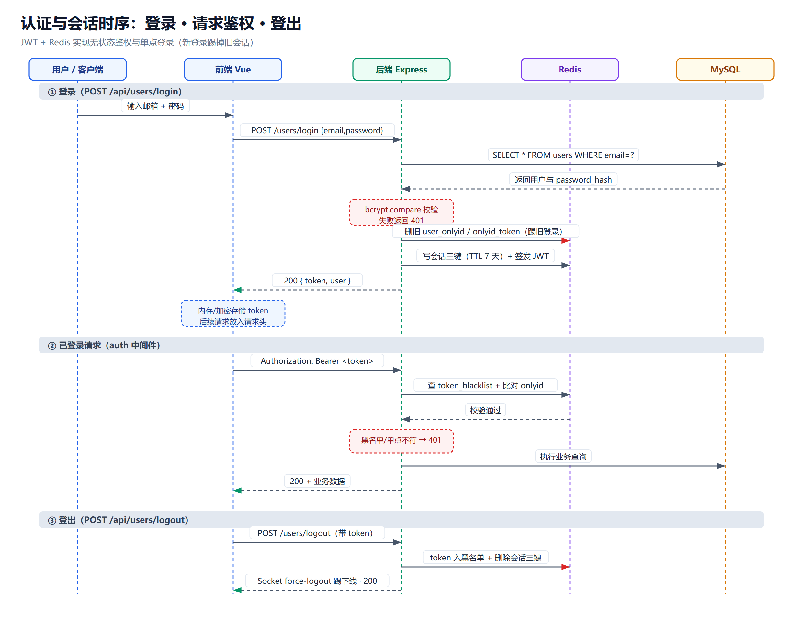
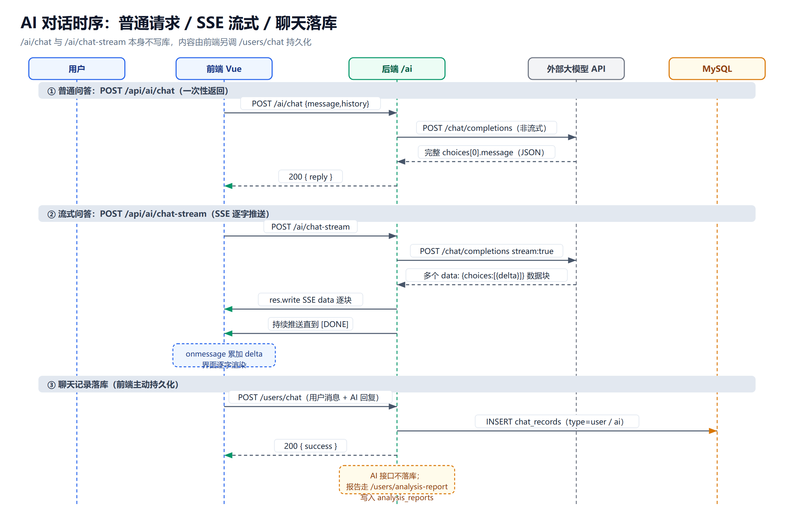
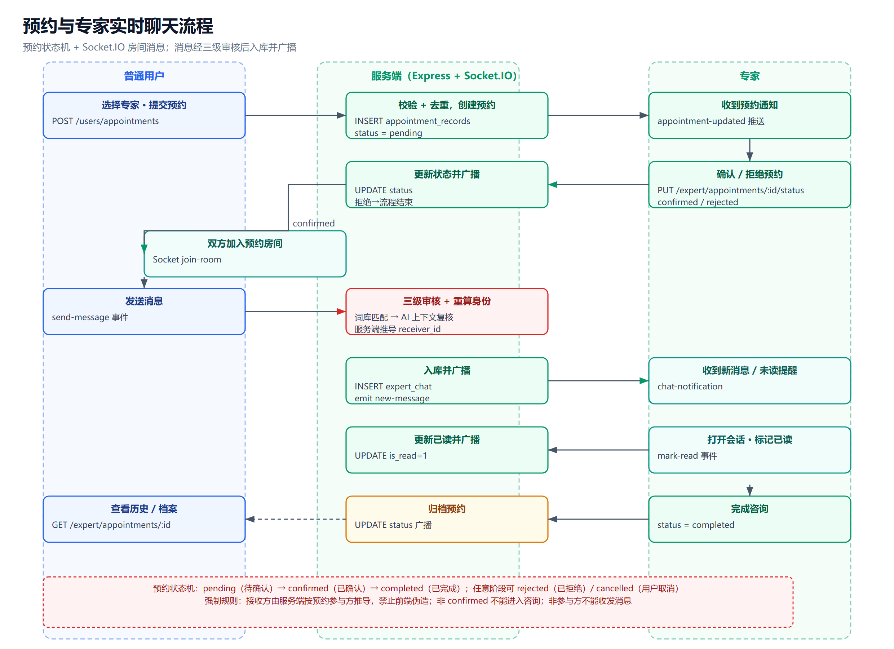
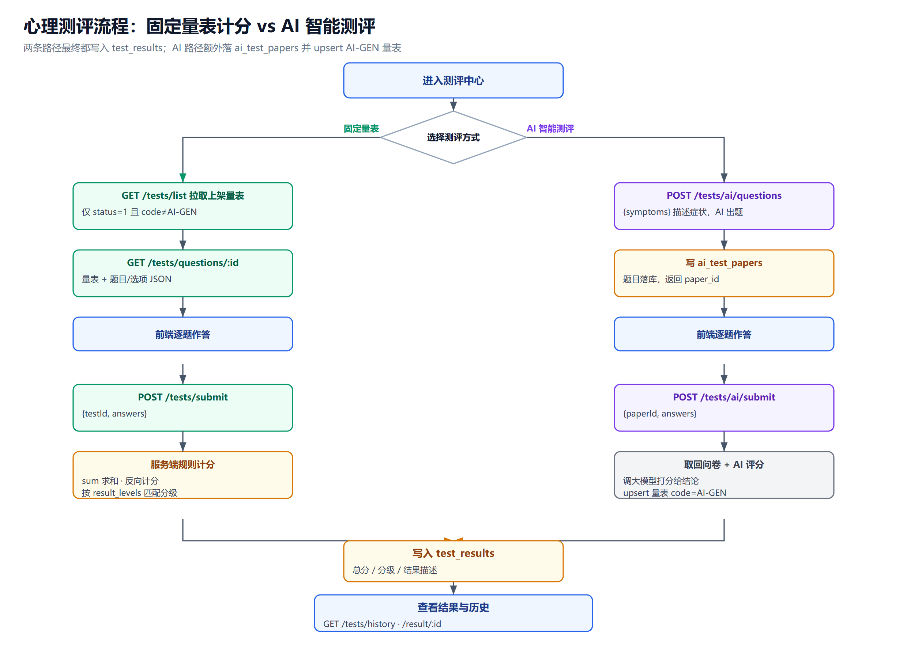
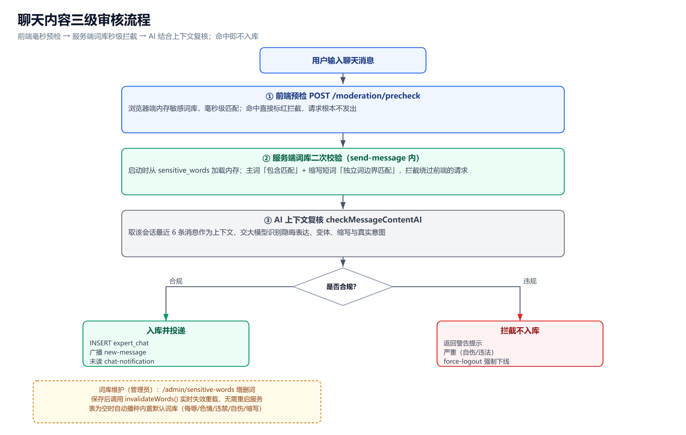
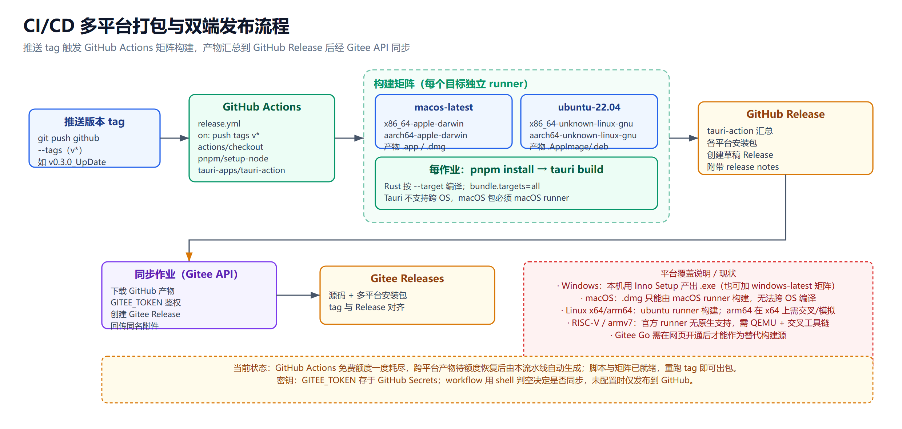

# 心愈（XinYu）工程架构总览

> 本文用 10 张工程图说明心愈心理健康桌面应用的**系统架构、前后端结构、数据库关系、核心业务流程与 CI/CD 流水线**，帮助快速理解整个项目。
>
> 配套文档：接口字段、JSON 示例与数据表细节见 **[API.md](./API.md)**。

- **桌面端**：Tauri 2 + Vue 3 + TypeScript + Vite（Rust 壳 + 系统 WebView，内置本地 SQLite 支持离线测评）
- **服务端**：Node.js + Express + Socket.IO（HTTP 端口 `3001`）
- **存储**：MySQL（库名 `xinyu`，12 张表）+ Redis（验证码 / 会话 / 限流 / 词库）
- **外部依赖**：大模型 API（对话 / 报告 / 出题 / 评分 / 内容复核）、SMTP 邮件、微信 / QQ OAuth
- **角色**：`role` 1 普通用户 / 2 专家 / 3 管理员

> 图表为矢量 SVG（`docs/images/*.svg`）并附同名高清 PNG（本文引用 PNG，GitHub/Gitee 均可直接显示）。
> 修改架构后运行 `node docs/diagrams/gen.js` 可零依赖重新生成全部 SVG。

---

## 1. 系统总体架构

客户端通过三种通道与服务端通信：**HTTPS REST/JSON**（业务增删改查）、**WebSocket（Socket.IO）**（实时聊天与状态广播）、**SSE**（AI 回复逐字流式推送）。Express 经统一鉴权中间件后分发到 7 个路由模块，底层访问 MySQL、Redis 与外部服务。



**关键设计**

- 桌面端与浏览器共用同一套 Vue 前端；Tauri 壳额外提供本地 SQLite 与原生命令（离线测评）。
- 后端 HTTP 与 Socket.IO 共用同一个 3001 端口和同一套 JWT 鉴权。
- AI 接口本身**不落库**，聊天与报告由前端拿到结果后再调业务接口持久化。

---

## 2. 前端工程结构

前端源码在 `frontend/`，分为 Web 源码 `src/` 与 Tauri 原生壳 `src-tauri/` 两部分。



- `src/api/`：基于 axios 封装的 `request.ts`（统一注入 Bearer Token、拦截 401/429），按业务拆为 user / ai / tests / admin / expert / moderation。
- `src/views/`：用户端、专家端、管理后台（`admin/`）、登录注册（`auth/`）页面。
- `src/stores/`：Pinia（user / settings / loading）；`src/router/` 含路由表与登录守卫。
- `src/utils/`：加密存储 `secureStore`、自动更新 `updater`、报告渲染、表单校验等。
- `src-tauri/src/main.rs`：Rust 本地命令（`get_tests`、`submit_test_result` 等）与更新源配置；`tauri.conf.json` 中 `bundle.targets = "all"`。

---

## 3. 后端工程结构

后端源码在 `backend/src/`，采用「入口 → 中间件 → 路由 → 工具 / 数据」的分层结构。



- `index.ts`：创建 Express、httpServer 与 Socket.IO，挂载中间件和全部路由，维护在线连接表。
- `middleware/auth.ts`：JWT 验签、token 黑名单校验、onlyId 单点登录校验；`errorHandler` 统一捕获异步异常（路由用 `asyncHandler` 包装）。
- `routes/`：users / auth / tests / ai / expert / admin / moderation 七个模块。
- `utils/`：`aiClient`（多厂商流式适配）、`moderation`（词库 + AI 复核）、`tokenManager`（会话与黑名单）、`guards`（预约归属校验）。
- `db/`：`mysql.ts`（mysql2 连接池）、`redis.ts`（ioredis）。

---

## 4. 数据库 ER 关系

MySQL 库 `xinyu` 共 **12 张表**，以 `users` 为中心。建表脚本为 `backend/db/schema.sql`，未建物理外键，关系由应用层维护（删除用户时在代码中级联清理 8 张关联表）。



各表字段、类型、约束、JSON 字段示例与 Redis 键说明，详见 **[API.md 附录 A](./API.md#附录-a数据库与数据表设计)**；每个接口读 / 写哪张表见 **[API.md 附录 B](./API.md#附录-b接口数据表映射总表)**。

---

## 5. 认证与会话：JWT + Redis 单点登录

登录成功后服务端生成随机 `onlyId` 与 JWT，在 Redis 维护「用户 → onlyId → token」三组键；**新登录会删除旧会话（单点登录，踢掉旧设备）**。每次请求经 auth 中间件验签、查黑名单、比对 onlyId；登出时把 token 加入黑名单并删除会话，同时通过 Socket 强制下线。



---

## 6. AI 对话：普通 / SSE 流式 / 落库

- `POST /api/ai/chat`：一次性返回完整回复。
- `POST /api/ai/chat-stream`：服务端以 `text/event-stream` 逐块 `res.write` 推送，前端累加 `delta` 逐字渲染，直到 `[DONE]`。
- 对话内容由前端再调 `POST /users/chat` 写入 `chat_records`；心理报告走 `/users/analysis-report` 写入 `analysis_reports`。



---

## 7. 预约与专家实时聊天

预约遵循状态机 `pending → confirmed → completed`，并可 `rejected / cancelled`。确认后双方通过 Socket `join-room` 进入预约房间；消息经三级审核后由服务端重算接收方身份、写入 `expert_chat` 并广播 `new-message`，未读发送 `chat-notification`，`mark-read` 后广播已读状态。



**强制规则**：接收方由服务端按预约参与方推导，禁止前端伪造；非 `confirmed` 不能咨询；非参与方不能收发消息。

---

## 8. 心理测评：固定量表 vs AI 智能测评

- **固定量表**：拉取上架量表与题目 → 作答 → 服务端按 `result_levels` 规则计分（求和、反向计分）并匹配分级。
- **AI 智能测评**：依据症状描述由大模型实时出题，题目先落 `ai_test_papers`（返回 `paper_id`）→ 作答提交 → 服务端取回原问卷、调大模型评分，并 upsert 编码为 `AI-GEN` 的量表。

两条路径最终都写入 `test_results`。



---

## 9. 聊天内容三级审核

1. **前端预检**（`/moderation/precheck`）：浏览器内存词库毫秒级匹配，命中即拦截，请求不发出。
2. **服务端词库校验**：Socket 收到消息后用内存词库二次匹配（主词包含匹配 + 缩写短词词边界匹配）。
3. **AI 上下文复核**：取最近 6 条消息作为上下文，交大模型识别隐晦表达、变体与真实意图。

合规才入库并投递；违规不入库并警告，涉及自伤 / 违法等严重情形触发 `force-logout`。管理员维护词库后实时失效重载，无需重启。



---

## 10. CI/CD 多平台打包与双端发布

推送 `v*` tag 触发 GitHub Actions（`.github/workflows/release.yml`）矩阵构建：macOS runner 产出 x86_64 / aarch64 的 `.dmg`，Ubuntu runner 产出 x86_64 / aarch64 的 `.AppImage/.deb`；tauri-action 汇总到 GitHub Release，再由同步作业通过 Gitee API 回传同名附件到 Gitee Releases。



**平台限制与现状**

- Tauri **不支持跨操作系统编译**：`.dmg` 只能在 macOS runner 构建；Windows `.exe` 当前由本机 Inno Setup 产出（也可加 `windows-latest` 矩阵）。
- RISC-V / armv7 等架构官方 runner 无原生支持，需 QEMU + 交叉工具链，暂未纳入。
- Gitee Go 需在 Gitee 网页开通后方可作为替代构建源。
- 免费构建额度耗尽期间无跨平台产物；流水线脚本与矩阵已就绪，额度恢复后重跑 tag 即可出包。

---

## 附：重新生成图表

图表由零依赖 Node 脚本生成（无需安装任何 npm 包）：

```bash
node docs/diagrams/gen.js
```

- 绘图核心库：`docs/diagrams/lib.js`
- 结构图：`docs/diagrams/figures-structure.js`（总体 / 前端 / 后端 / ER）
- 流程时序图：`docs/diagrams/figures-flow-a.js`、`figures-flow-b.js`
- 矢量产物：`docs/images/*.svg`；本文引用的同名 PNG 可由 Edge/Chrome 无头模式从 SVG 导出：

```bash
msedge --headless --disable-gpu --force-device-scale-factor=2 \
  --screenshot=docs/images/architecture.png --window-size=1240,860 \
  "file:///绝对路径/docs/images/architecture.svg"
```
